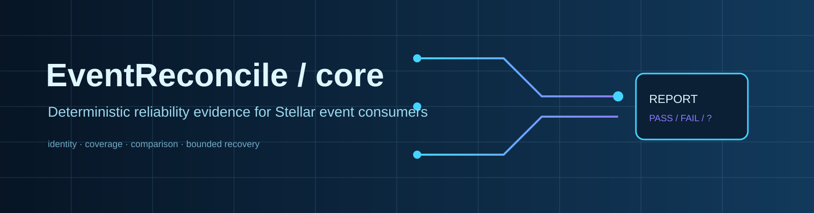
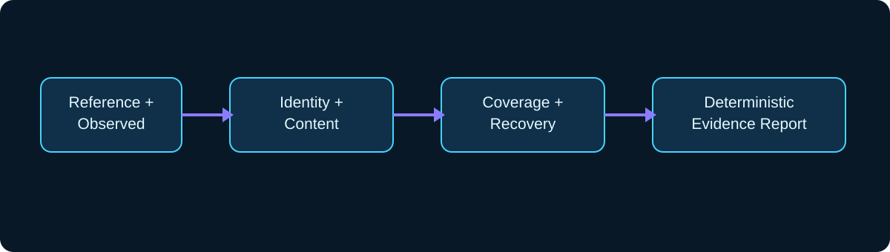

# EventReconcile-core



[](https://github.com/EventReconcile/EventReconcile-core/actions/workflows/ci.yml) [](LICENSE) [](https://go.dev/) [](docs/PROJECT_STATUS.md)

The authoritative Go domain implementation for deterministic Stellar event reconciliation and bounded recovery verification.

## Repository role

Core owns event identity, content comparison, duplicate/conflict classification, coverage and provenance assessment, deterministic reports, recovery claims, and the versioned JSON-compatible contracts. It does not import the CLI or adapters and does not perform network access, signing, writes or repair.

## Architecture



Reference and observed records are compared only within declared evidence. A matching dataset does not prove global blockchain completeness; unsupported identity or insufficient coverage remains `INCONCLUSIVE`.

## Quickstart

Requirements: Go 1.25.x.

```powershell
go vet ./...
go test -count=1 ./...
```

The local module is currently pre-publication. Cross-repository development uses the documented local replacement; release builds must use a released compatible core version.

## Documentation and status

- [Project status](docs/PROJECT_STATUS.md)
- [Schemas](schema/)
- [Contributing](CONTRIBUTING.md)
- [Security](SECURITY.md)
- [Code of conduct](CODE_OF_CONDUCT.md)
- [Changelog](CHANGELOG.md)

## Related repositories

- [EventReconcile-cli](https://github.com/EventReconcile/EventReconcile-cli) — offline command-line workflows and report output.
- [EventReconcile-adapters](https://github.com/EventReconcile/EventReconcile-adapters) — source-specific normalization and provenance mapping.

## License

Licensed under [Apache-2.0](LICENSE).
